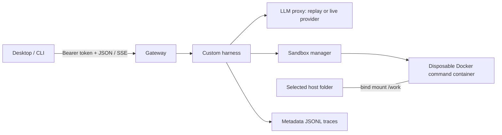

# Project A — agent runtime, Checkpoint 1

A small Python coding-agent runtime with a native Tk desktop client, a headless CLI,
four HTTP services, disposable Docker sandboxes, and 15 B1–B5 benchmark tasks.
The application and offline tests use only Python's standard library.

This is the standalone repository for Project A. Assignment: [Project A](https://github.com/deeppavlov/agentic-course-itmo/blob/main/projects/A-agent-runtime.md).

## Scope and current evidence

Checkpoint 1 implements the server/client path, a custom tool-calling harness,
Docker execution, v0 contracts, initial ADRs, and the B1–B5 runner. The default
model is **synthetic replay**, explicitly labelled in events and reports. Replay
checks the runtime and fixture outcomes; it does not measure an LLM's ability.

The current local validation runs the four HTTP services against a **test-only
local fixture executor**. Actual Docker isolation and Compose startup require
`make test-docker` on a host with Docker socket access. This development environment
denied access to the daemon, including after an escalation attempt; those checks
have not been run here. See [validation report](docs/report.md).

**Mounting at this checkpoint is same-host only:** the selected folder must exist
under `WORKSPACE_ROOT` on the Docker host. It is genuinely bind-mounted at `/work`,
so file changes are visible in both directions. Remote client-folder mounting is
the explicit Checkpoint 2 work item; this implementation does not claim A-2.3 or
A-3 remote-mount compliance.

## Architecture



The manager alone receives the Docker socket. The proxy alone receives the model
API key. A session locks a workspace; each operation gets a fresh container with
the same mount. Shell variables, installed packages and background processes do
not persist between operations. See [ADRs](docs/adr/README.md).

## Start the server

Prerequisites: Linux, Python 3.12+, Docker Engine supporting API v1.47, and Docker
Compose v2 or newer. GNU Make is optional and provides the shortcuts below. The first build needs the pinned Python base image. Runtime
services install no third-party Python dependencies. Docker checks assume cgroup v2.

Run from this directory:

```bash
python3 -m scripts.init
docker compose up --build
```

`make init` writes an ignored `.env` with random client/internal tokens, your
UID/GID, and an absolute workspace path. It also creates `workspaces/demo`.
Existing `.env` files and demo folders are preserved. Start as a non-root user;
the sandbox rejects UID or GID zero. Alternatively, copy `.env.example` and fill
in the tokens, UID/GID and absolute path yourself.

The gateway listens at `http://127.0.0.1:18080` by default (`GATEWAY_PORT` in `.env`). Only the gateway publishes a port.
The healthchecks query actual service endpoints; the manager also checks Docker.
`make up` starts the same stack in the background and waits for readiness.

```bash
docker compose ps
curl --noproxy '*' http://127.0.0.1:18080/health
```

If Docker reports permission denied, fix daemon access on your machine before
starting. Do not make the Docker socket world-writable. On SELinux hosts, bind
mount policy may also need administrator configuration; it has not been tested.

If Connect reports an unexpected HTTP response, check `/health` at the configured
port. It must return `{"status": "ok", "service": "gateway", "v": 0}`.
`docker compose ps` must show `127.0.0.1:18080->8000/tcp` for the gateway (or your
chosen `GATEWAY_PORT`). A bare `8000/tcp` means the host port is not published.
The gateway uses a separate `frontend` bridge for publishing; internal service
traffic stays on the `internal` bridge. See [Docker port publishing](https://docs.docker.com/engine/network/port-publishing/).
If another application occupies your chosen port, update `GATEWAY_PORT` in `.env`,
recreate the stack with `docker compose up --build -d --wait`, and restart the
desktop client so it reads the new address. The client verifies gateway identity
before sending its access token on Connect.

## Desktop demo

```bash
make client
```

The client runs from source; there is no JavaScript build or package installation.
Python needs Tk support (`python3-tk` on Debian/Ubuntu, `python3-tkinter` on Fedora)
and a graphical session. CLI mode works without Tk or a display.

1. The app reads the server address and client token from `.env`.
2. Choose `workspaces/demo`, leave mode `rw`, and click **Connect**.
3. In default replay mode, send this exact bundled task prompt:

   ```text
   [BAF B1.1] Read config/app.yaml and write only the service port to answer.txt.
   ```

4. Observe model/tool events and the final result. Open `workspaces/demo/answer.txt`;
   it should contain `8137`.
5. **Cancel** terminates the active command container and makes the session terminal.
   Connect again for another session. Closing the window attempts session release.
6. **Reconnect events** resumes the existing session using the last event sequence.
   It does not recreate a session lost to a server restart.

In live mode, arbitrary prompts are supported. In replay mode, other prompts return
an explanatory message without modifying files.

## Headless client

The CLI reads `.env` in the current directory. Alternatively set `SERVER_URL` and
`CLIENT_TOKEN`, or use global `--server` / `--token` arguments.

```bash
python3 -m client connect --workspace demo --mode rw
# Use the session_id printed by connect:
python3 -m client send --session SESSION_ID --text '[BAF B1.1] Read config/app.yaml and write only the service port to answer.txt.' --wait
python3 -m client collect --session SESSION_ID
python3 -m client edit --folder workspaces/demo --file answer.txt --append READY
python3 -m client watch --session SESSION_ID --run RUN_ID --after LAST_EVENT_ID
python3 -m client cancel --session SESSION_ID
python3 -m client release --session SESSION_ID
```

Use `--request-id` on `connect` or `send` when retrying after a transport failure.
Reuse the same ID and payload; a conflicting payload is rejected. Automatic event
reconnection never resubmits the user message.

## Tests and benchmarks

```bash
make test-ci      # Offline: unit, CLI, HTTP integration, all 15 replay tasks
make test-ui      # CLI scenarios against the local HTTP test stack
make test-infra   # Contracts, lifecycle, cancellation, timeout, configuration
make test-docker  # REAL Docker checks; first build the images with Compose
make baf-smoke   # Running Compose stack: B1.1–B5.1
make baf         # Running Compose stack: all 15 tasks, one repeat
```

`test-ci` needs neither Docker nor an external network. Its local executor is
under `tests/` and is never a production fallback. Resource configuration assertions
in that suite are not evidence that Docker enforces those limits. `test-docker`
exercises real mounts, non-root execution, read-only root and workdir, `.git`
protection, network namespace, cgroup settings, temporary disk, cancellation and
cleanup. Full adversarial limit testing remains Checkpoint 2 work.

If `make` is unavailable (as in the development environment), use these direct equivalents:

| Shortcut | Direct command |
|---|---|
| `make init` | `python3 -m scripts.init` |
| `make client` | `python3 -m client gui` |
| `make test-ci` | `python3 -m scripts.validate` |
| `make test-docker` | `python3 -m scripts.docker_check` |
| `make baf` | `python3 -m scripts.benchmark` |
| `make baf-smoke` | `python3 -m scripts.benchmark --smoke` |

The repository's [GitHub workflow](.github/workflows/project-a.yml) runs both
offline and Docker jobs, including replay against the actual Compose stack. It
has not been executed remotely as part of this implementation.

```bash
python3 -m scripts.benchmark --task B5.3 --pair custom+replay
python3 -m scripts.benchmark --repeats 3 --pair custom+YOUR_MODEL
```

Raw benchmark results append to `results/baf.jsonl`; real Docker checks write
`results/docker-check.json`. The pair label is user-supplied metadata; the actual
proxy mode/model is recorded separately. Generated fixture folders are kept under
`WORKSPACE_ROOT` for inspection. See [BAF design](docs/baf.md).

## Connect a real model

Edit these fields in `.env`:

```dotenv
LLM_MODE=live
LLM_PROVIDER_URL=https://YOUR_PROVIDER/v1
LLM_API_KEY=YOUR_KEY
LLM_MODEL=YOUR_EXACT_MODEL_ID
LLM_EXTRA_JSON='{}'
```

The proxy appends `/chat/completions` to the base URL and supports the standard
messages/functions tool-calling format. Provider-specific options can go in
`LLM_EXTRA_JSON`, for example disabling thinking if required by your provider.
The adapter follows the [DeepSeek Chat Completions contract](https://api-docs.deepseek.com/api/create-chat-completion/).
Provider compatibility has been tested with mocked responses, not a paid call.

```bash
docker compose up -d --build
make baf PAIR=custom+YOUR_EXACT_MODEL_ID
```

Choose a model permitted by the course and record its exact version, Intelligence
Index and verification date before collecting quality results. No model ranking
or model-quality result is claimed in this checkpoint implementation.

## Traces and cleanup

Metadata-only session traces are in the `traces` named volume. The event stream
contains actual tool output; persistent traces omit prompts, file contents and
tool output. Both carry session, run/trace and operation IDs, durations and outcomes;
model events include token counts and provider/model identity.

```bash
docker compose exec harness python -c 'from pathlib import Path; print("\n".join(p.name for p in Path("/traces").glob("*.jsonl")))'
docker compose down -v
```

Graceful shutdown releases sessions and removes their dynamic containers. Manager
startup also removes leftover containers with this installation's instance label.
`down -v` deletes the server trace volume. It deliberately preserves your original
host workspace folders and benchmark outputs. Forced manager/host failure recovery
needs further work; see [status and limitations](docs/checkpoint-status.md).

## Code map

| Path | Purpose |
|---|---|
| `runtime/gateway.py` | Client authentication boundary and forwarding |
| `runtime/harness.py` | Agent loop, context, tool dispatch, session events |
| `runtime/sandbox_manager.py` | Workspace ownership and command-container lifecycle |
| `runtime/docker_engine.py` | Docker Engine HTTP API over a Unix socket |
| `runtime/llm_proxy.py` | Synthetic replay and live provider adapter |
| `client/` | Shared API client, CLI, native desktop UI |
| `contracts/` | Versioned JSON Schema contracts |
| `baf/cases.py` | Fifteen tasks, fixtures, replay tool calls and checkers |
| `docs/` | Harness explanation, protocol semantics, ADRs and checkpoint report |

Regenerate schemas after protocol changes with `make contracts`. Tests reject
checked-in schemas that drift from their Python definitions.
