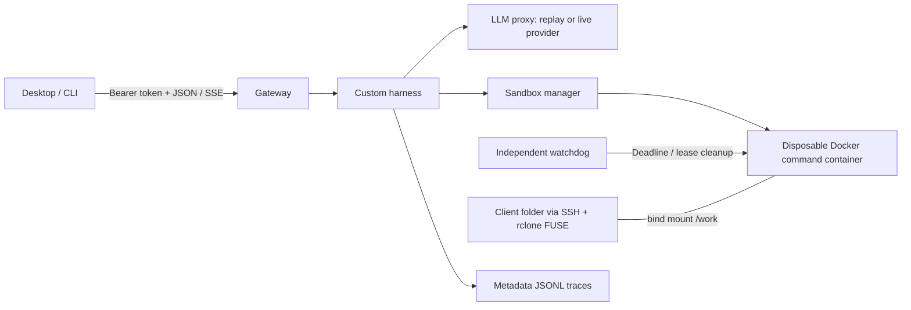

# Project A — agent runtime

A small Python coding-agent runtime with a native Tk desktop client, a headless CLI,
four HTTP services, an independent sandbox watchdog, disposable Docker sandboxes,
and 39 benchmark tasks spanning B1–B9 and composites C1–C4.
The application and offline tests use only Python's standard library.

This is the standalone repository for Project A. Assignment: [Project A](https://github.com/deeppavlov/agentic-course-itmo/blob/main/projects/A-agent-runtime.md).

## Scope and current evidence

Checkpoint 1 implements the server/client path, a custom tool-calling harness,
Docker execution, v0 contracts, initial ADRs, and the B1–B5 runner. The default
model is **synthetic replay**, explicitly labelled in events and reports. Replay
checks the runtime and fixture outcomes; it does not measure an LLM's ability.

Checkpoint 2 adds remote client-folder mounting, export quotas, independent command
deadlines, adversarial acceptance checks, 15 additional BAF tasks and measurement
tools. Offline validation uses a **test-only local fixture executor**; real Docker
and SSH/FUSE checks are separate. See the [Checkpoint 2 report](docs/cp2-report.md),
[historical validation report](docs/report.md) and [current status](docs/checkpoint-status.md).

The Fedora client → Ubuntu VM mount acceptance completed with **nine passing
checks** in `results/remote-mount.json`; the user also confirmed the GUI path and
client-visible output. The final **Ubuntu `make check-all` passed**: 169
offline tests, Docker isolation/grading, 10 hardening checks, **39/39 real-Docker
replay tasks**, and nine SSH/FUSE checks. The final Fedora offline suite passed
169 tests, including checker and client-recovery regressions. Filesystem and sandbox measurements completed with ten repeats per
metric; [tables and limitations](docs/cp2-report.md#measured-performance) and
[raw evidence](docs/evidence/cp2/README.md) are retained.

The first live pair completed **39 tasks × 3 repeats**: **114/117 (97.4%)**
after audited observation-checker corrections (original verdicts: 109/117).
All original failures and evidence are retained. A separate C3 follow-up after
fixing the client's timeout passed 3/3 and does not replace original attempts.
See the [live matrix](docs/live-results.md), [corrections](docs/evaluation-corrections.md)
and [follow-up](docs/c3-followup.md). Comparison with additional pairs remains CP3 work.

The primary workspace is a Linux client's folder exported over SSH and mounted
on another Linux Docker host with pinned rclone/FUSE. See
[two-machine setup and limitations](docs/remote-mount.md). Local read-write binds
remain available through an explicit trusted-development opt-in.

## Architecture



The manager and independent watchdog receive the Docker socket and share a
privileged control-plane trust boundary. The LLM proxy alone receives the model
API key and optional provider proxy socket. A session locks a workspace; each operation gets a fresh container with
the same mount. Shell variables, installed packages and background processes do
not persist between operations. The remote exporter limits regular-file content
to 256 MiB and entries to 4096. Deadlines survive an individual manager or harness
loss, but timely removal depends on Docker and at least one control-plane service.
See [hardening and failure boundaries](docs/hardening.md) and [ADRs](docs/adr/README.md).

## Start the server

Prerequisites: Linux, Python 3.12+, Docker Engine supporting API v1.47, and Docker
Compose v2 or newer. GNU Make is optional and provides the shortcuts below. The first build needs the pinned Python base image. Runtime
services install no third-party Python dependencies. Docker checks assume cgroup v2.

Run from this directory:

```bash
python3 -m scripts.init
docker compose up --build
```

`make init` writes an ignored `.env` with random client/internal tokens, your
UID/GID, and an absolute workspace path. It also creates `workspaces/demo`.
Existing `.env` files and demo folders are preserved. Start as a non-root user;
the sandbox rejects UID or GID zero. Alternatively, copy `.env.example` and fill
in the tokens, UID/GID and absolute path yourself.

The initializer uses `.env.example`, which explicitly enables `ALLOW_LOCAL_RW=1`
for trusted local demos/replay. The runtime and Compose default are `0`. Set it
to `0` for untrusted/live tasks and use the quota-controlled remote export. Local
binds have no aggregate disk quota; their per-file limit is not equivalent.

The gateway listens at `http://127.0.0.1:18080` by default (`GATEWAY_PORT` in `.env`). Only the gateway publishes a port.
The healthchecks query actual service endpoints; the manager also checks Docker.
`make up` starts the same stack in the background and waits for readiness.

```bash
docker compose ps
curl --noproxy '*' http://127.0.0.1:18080/health
```

If Docker reports permission denied, fix daemon access on your machine before
starting. Do not make the Docker socket world-writable. On SELinux hosts, bind
mount policy may also need administrator configuration; it has not been tested.

If Connect reports an unexpected HTTP response, check `/health` at the configured
port. It must return `{"status": "ok", "service": "gateway", "v": 0}`.
`docker compose ps` must show `127.0.0.1:18080->8000/tcp` for the gateway (or your
chosen `GATEWAY_PORT`). A bare `8000/tcp` means the host port is not published.
The gateway uses a separate `frontend` bridge for publishing; internal service
traffic stays on the `internal` bridge. See [Docker port publishing](https://docs.docker.com/engine/network/port-publishing/).
If another application occupies your chosen port, update `GATEWAY_PORT` in `.env`,
recreate the stack with `docker compose up --build -d --wait`, and restart the
desktop client so it reads the new address. The client verifies gateway identity
before sending its access token on Connect.

## Desktop demo

```bash
make client
```

The client runs from source; there is no JavaScript build or package installation.
Python needs Tk support (`python3-tk` on Debian/Ubuntu, `python3-tkinter` on Fedora)
and a graphical session. CLI mode works without Tk or a display.

1. The app reads the server address and client token from `.env`.
2. Choose `workspaces/demo`, leave mode `rw`, and click **Connect**.
3. In default replay mode, send this exact bundled task prompt:

   ```text
   [BAF B1.1] Read config/app.yaml and write only the service port to answer.txt.
   ```

4. Observe model/tool events and the final result. Open `workspaces/demo/answer.txt`;
   it should contain `8137`.
5. **Cancel** terminates the active command container and makes the session terminal.
   Connect again for another session. Closing the window attempts session release.
6. **Reconnect events** resumes the existing session using the last event sequence.
   It does not recreate a session lost to a server restart.

In live mode, arbitrary prompts are supported. In replay mode, other prompts return
an explanatory message without modifying files.

## Headless client

The CLI reads `.env` in the current directory. Alternatively set `SERVER_URL` and
`CLIENT_TOKEN`, or use global `--server` / `--token` arguments.

```bash
python3 -m client connect --workspace demo --mode rw
# Use the session_id printed by connect:
python3 -m client send --session SESSION_ID --text '[BAF B1.1] Read config/app.yaml and write only the service port to answer.txt.' --wait
python3 -m client collect --session SESSION_ID
python3 -m client edit --folder workspaces/demo --file answer.txt --append READY
python3 -m client watch --session SESSION_ID --run RUN_ID --after LAST_EVENT_ID
python3 -m client cancel --session SESSION_ID
python3 -m client release --session SESSION_ID
```

Use `--request-id` on `connect` or `send` when retrying after a transport failure.
Reuse the same ID and payload; a conflicting payload is rejected. Automatic event
reconnection never resubmits the user message.

## Tests and benchmarks

```bash
make test-ci      # Offline: unit, CLI, HTTP integration, all 39 replay tasks
make test-ui      # CLI scenarios against the local HTTP test stack
make test-infra   # Contracts, lifecycle, cancellation, timeout, configuration
make test-docker  # REAL Docker checks; first build the images with Compose
make test-b6-docker # REAL Docker grading: correct/incorrect code, timeout, isolation
make baf-smoke   # Running Compose stack: nine simple tasks, B1.1–B9.1
make baf         # Running Compose stack: all 39 tasks, one repeat
make test-hardening # Real limits, export quotas and process-loss cleanup
make check-all   # Prepared Docker + SSH/FUSE host; isolated replay acceptance
make measure-sandbox # Docker startup/exec/resource measurements
```

`test-ci` needs neither Docker nor an external network. Its local executor is
under `tests/` and is never a production fallback. Resource configuration assertions
in that suite are not evidence that Docker enforces those limits. `test-docker`
exercises real mounts, non-root execution, read-only root and workdir, `.git`
protection, network namespace, cgroup settings, temporary disk, cancellation and
cleanup. `test-hardening` adds adversarial limits, quota and process-loss probes.
`check-all` creates a separate temporary replay stack; it does not restart the
user's live stack or call a paid model. Existing-sshd development hosts can use
`make check-all CHECK_ARGS=--existing-sshd`. See [hardening](docs/hardening.md) and
[complete acceptance and measurement commands](docs/performance.md).

B7 covers transfer timing, inherited access policies, and contradictory rules.
The agent writes `answer.json`; independent data-only checkers verify decisions,
calculations and rule IDs against the original fixture. See [BAF details](docs/baf.md#b7-reasoning).
With rebuilt Compose services, run one task with
`python3 -m scripts.benchmark --task B7.1` (or `B7.2` / `B7.3`).

B8 combines multiple sources: quarterly sales from five CSVs, accepted decisions
from ten meeting protocols, and the applicable regulation with differences between
two versions. Checkers validate `answer.json`, including source citations.
See [B8 contracts and grading](docs/baf.md#b8-synthesis-from-sources).
After rebuilding Compose services, select `--task B8.1`, `B8.2` or `B8.3`.

If `make` is unavailable, use these direct equivalents:

| Shortcut | Direct command |
|---|---|
| `make init` | `python3 -m scripts.init` |
| `make client` | `python3 -m client gui` |
| `make test-ci` | `python3 -m scripts.validate` |
| `make test-docker` | `python3 -m scripts.docker_check` |
| `make test-b6-docker` | `python3 -m scripts.check_b6` |
| `make test-hardening` | `python3 -m scripts.hardening_check` |
| `make check-all` | `python3 -m scripts.check_all` |
| `make measure-sandbox` | `python3 -m scripts.measure_sandbox` |
| `make baf` | `python3 -m scripts.benchmark` |
| `make baf-smoke` | `python3 -m scripts.benchmark --smoke` |

The repository's [GitHub workflow](.github/workflows/project-a.yml) runs both
offline tests and the complete prepared-host acceptance suite, including replay
against actual Compose. The presence of the workflow is not evidence that a
specific GitHub run passed.

```bash
python3 -m scripts.benchmark --task B5.3 --pair custom+replay
python3 -m scripts.benchmark --task B6.1 --pair custom+replay
python3 -m scripts.benchmark --repeats 3 --pair custom+YOUR_MODEL
```

Raw benchmark results append to `results/baf.jsonl`; real Docker checks write
`results/docker-check.json`. The pair label is user-supplied metadata; the actual
proxy mode/model is recorded separately. Generated fixture folders are kept under
`WORKSPACE_ROOT` for inspection. See [BAF design](docs/baf.md).

B6 adds code-generation tasks and an independent function evaluator. The benchmark
process needs local Linux Docker access for grading, even when `--ssh-host` sends
agent runs to another server; the grading image must be built on that local host.
After releasing
the agent session, it snapshots only the declared candidate source, mounts it
read-only, and runs each hidden input in a fresh networkless container. Expected answers stay outside
the container. Rebuild `sandbox.Dockerfile` after updating: it now includes the
trusted function adapter. Missing Docker access fails the check; it never falls
back to executing generated code on the host. B6.1–B6.4 and C1/C3 have 53 hidden
vectors total. Details: [code grading](docs/baf.md#b6-code-generation) and
[original tasks/composites](docs/baf-additions.md).

## Connect a real model

Edit these fields in `.env`:

```dotenv
LLM_MODE=live
LLM_PROVIDER_URL=https://YOUR_PROVIDER/v1
LLM_API_KEY=YOUR_KEY
LLM_MODEL=YOUR_EXACT_MODEL_ID
LLM_EXTRA_JSON='{}'
```

The proxy appends `/chat/completions` to the base URL and supports the standard
messages/functions tool-calling format. Provider-specific options can go in
`LLM_EXTRA_JSON`, for example disabling thinking if required by your provider.
The adapter follows the [DeepSeek Chat Completions contract](https://api-docs.deepseek.com/api/create-chat-completion/).
The first complete campaign used DeepSeek V4.1 Flash 1017; its
[measured results and limitations](docs/cp2-report.md#first-pair-results-and-corrections)
apply to that model/configuration. Set `ALLOW_LOCAL_RW=0` and use
the remote-mounted client folder for live tasks.

On the server, rebuild/recreate Compose with the updated `.env`. On the client,
with the server's `CLIENT_TOKEN` and local grading image available:

```bash
python3 -m scripts.benchmark --ssh-host YOUR_SSH_ALIAS \
  --server-repo /home/YOUR_USER/itmo-agent-runtime-track-a \
  --repeats 3 --pair custom+YOUR_EXACT_MODEL_ID --output results/live-campaign.jsonl
```

Choose a model permitted by the course and record its exact version, Intelligence
Index and verification date before collecting quality results. The first pair's
campaign is complete; comparative pair selection remains pending. Summarize raw
results with `python3 -m scripts.summarize_benchmark`; see
[repeats, completeness and statistics](docs/performance.md#summarize-a-model-campaign).

### Optional provider route through the client's proxy

If the server cannot reach the provider directly, forward a working **HTTP CONNECT
proxy** from the client through SSH. This is separate from folder mounting. First
create a private socket directory on the server (replace user/path/alias):

```bash
ssh YOUR_SSH_ALIAS 'install -d -m 700 /home/YOUR_USER/.local/run'
```

On the client, select the actual proxy listening port and leave SSH running:

```bash
read -r -p 'Local HTTP proxy port: ' PROXY_PORT
ssh -NT -o ExitOnForwardFailure=yes -o StreamLocalBindUnlink=yes \
  -o ServerAliveInterval=15 -o ServerAliveCountMax=3 \
  -R "/home/YOUR_USER/.local/run/provider-proxy.sock:127.0.0.1:${PROXY_PORT}" \
  YOUR_SSH_ALIAS
```

On the server, after the socket exists:

```bash
export LLM_PROXY_SOCKET_HOST=/home/YOUR_USER/.local/run/provider-proxy.sock
docker compose -f docker-compose.yml -f compose.llm-proxy.yml up -d --build --wait
```

Use the same overlay for later Compose updates. If SSH recreates the socket,
recreate the `llm-proxy` service so its bind points to the current socket. The
socket is mounted only into `llm-proxy`; provider TLS and certificate verification
remain end-to-end, and the API key stays on the server. Sandboxes remain
networkless. `LLM_HTTP_PROXY` is a mutually exclusive alternative when a TCP proxy
is already reachable from the server. See [ADR 0009](docs/adr/0009-provider-transport.md).

## Traces and cleanup

Metadata-only session traces are in the `traces` named volume. The event stream
contains actual tool output; persistent traces omit prompts, file contents and
tool output. Both carry session, run/trace and operation IDs, durations and outcomes;
model events include token counts and provider/model identity.

```bash
docker compose exec harness python -c 'from pathlib import Path; print("\n".join(p.name for p in Path("/traces").glob("*.jsonl")))'
docker compose down -v
```

Graceful shutdown releases sessions and removes their dynamic containers. Manager
startup also removes leftover containers with this installation's instance label.
`down -v` deletes the server trace volume. It deliberately preserves your original
host workspace folders and benchmark outputs. The independent watchdog removes
commands after their deadlines or remote-lease loss if the manager fails. This
does not recover in-memory sessions and cannot guarantee cleanup when Docker or
both control-plane services are unavailable. Transport recovery never
automatically reexecutes operations with ambiguous effects. See
[status and limitations](docs/checkpoint-status.md).

## Code map

| Path | Purpose |
|---|---|
| `runtime/gateway.py` | Client authentication boundary and forwarding |
| `runtime/harness.py` | Agent loop, context, tool dispatch, session events |
| `runtime/sandbox_manager.py` | Workspace ownership and command-container lifecycle |
| `runtime/sandbox_watchdog.py` | Independent deadline and remote-lease cleanup |
| `runtime/docker_engine.py` | Docker Engine HTTP API over a Unix socket |
| `runtime/llm_proxy.py` | Synthetic replay and live provider adapter |
| `client/` | Shared API client, CLI, native desktop UI |
| `contracts/` | Versioned JSON Schema contracts |
| `baf/cases.py` | Registry/dispatch for 39 deterministic benchmark tasks |
| `baf/additional_cases.py`, `baf/additional_checks.py` | Original variants, B9 and C1–C4; independent checks |
| `baf/code_evaluator.py`, `baf/code_checks.py` | Isolated candidate grading and 53 hidden vectors |
| `docs/` | Harness explanation, protocol semantics, ADRs and checkpoint report |

Regenerate schemas after protocol changes with `make contracts`. Tests reject
checked-in schemas that drift from their Python definitions.
