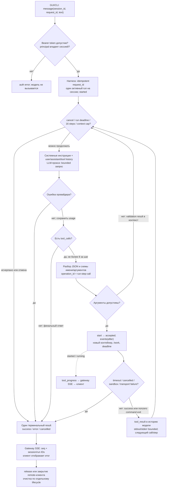

# ЧП2: подробная схема реализации

Основной режим: Linux-клиент на Fedora и Linux-сервер в отдельной Ubuntu VM.
VM служит машиной сервера; изоляцию каждой агентной команды обеспечивает Docker.
Код компонентов, их протоколы и границы доверия показаны ниже. Историческая
кампания `9555ba9` и последующие исправления различаются: её сохранённые события
разобраны отдельно в [двух конкретных трейсах](cp2-trace-walkthrough.md).

## Машины, процессы, контейнеры и данные

```mermaid
flowchart LR
    subgraph CLIENT["Машина клиента: Fedora, пользовательский процесс"]
        GUI["Tk desktop / CLI<br/>client.desktop, client.api"]
        RC["RemoteClient<br/>client.remote"]
        FILES["Выбранная локальная папка<br/>исходные файлы пользователя"]
        DAV["WorkspaceServer<br/>HTTP WebDAV на loopback<br/>RO/RW, квота, protected paths"]
        SSH["OpenSSH-клиент<br/>проверка host key"]
        GUI -->|"create / message / cancel / cursor"| RC
        RC -->|"создание экспортера, случайный export token"| DAV
        DAV <-->|"ограниченные файловые операции"| FILES
        RC -->|"SSH key auth; control pipe"| SSH
    end
    subgraph SERVER["Машина сервера: Ubuntu VM"]
        SSHD["sshd<br/>loopback TCP forwards"]
        HELPER["remote_mount: SSH helper<br/>владеет gateway-сессией"]
        GUARD["mount_guard: отдельный host-процесс<br/>владеет rclone/FUSE и lease"]
        MOUNT["WORKSPACE_ROOT/remote-ID<br/>настоящий FUSE mount"]
        LEASE[".remote-control: metadata lease<br/>без содержимого файлов"]
        DOCKER["Docker Engine<br/>host-root control plane"]
        subgraph COMPOSE["Compose: служебные контейнеры"]
            GW["gateway<br/>Bearer token → principal<br/>проверка владельца session_id"]
            H["harness<br/>история, цикл, события, лимиты"]
            LP["llm-proxy<br/>live / live-record / recorded / synthetic replay<br/>ключ только здесь"]
            SM["sandbox-manager<br/>сессии, операции, Docker lifecycle"]
            WD["sandbox-watchdog<br/>независимая очистка по deadline/lease"]
            TR["/traces: named volume<br/>JSONL метаданные"]
        end
        subgraph EXEC["Отдельный disposable sandbox на каждую операцию"]
            TOOL["RunCommand / ReadFile / WriteFile<br/>non-root; network none<br/>CPU/RAM/PIDs/time/disk limits"]
            WORK["/work: bind монтирования<br/>RO или RW"]
        end
        SSHD -->|"запуск helper; stdin/stdout JSON control"| HELPER
        HELPER -->|"private pipe: start / revoke / close; EOF"| GUARD
        GUARD -->|"запуск и остановка rclone/FUSE"| MOUNT
        GUARD -->|"обновление expiry примерно раз в секунду"| LEASE
        HELPER -->|"HTTP JSON create / release + client token"| GW
        GW -->|"internal HTTP JSON v0; INTERNAL_TOKEN"| H
        H -->|"messages + tool schemas"| LP
        LP -->|"assistant tool_calls / content; usage"| H
        H -->|"HTTP JSON v0: provision / start / events(after) / collect / cancel / release"| SM
        SM -->|"started / running / один result: stdout/stderr, error, duration"| H
        H -->|"append: IDs, tool, timing, outcome, tokens"| TR
        H -->|"события запуска"| GW
        SM -->|"Docker API по Unix socket"| DOCKER
        WD -->|"list / force-remove по immutable labels"| DOCKER
        WD -->|"проверка срока lease"| LEASE
        SM -->|"проверка lease перед операцией и во время ожидания"| LEASE
        DOCKER -->|"create / start / inspect / logs / remove"| TOOL
        MOUNT <-->|"bind mount существующего FUSE mount"| WORK
        TOOL <-->|"syscalls чтения/записи"| WORK
    end
    PROVIDER["Внешний провайдер модели<br/>HTTPS OpenAI-compatible API"]
    SSH <-->|"SSH: gateway local-forward + WebDAV reverse-forward"| SSHD
    SSHD <-->|"HTTP WebDAV в зашифрованном SSH-канале"| DAV
    GUARD <-->|"HTTP WebDAV через server loopback reverse-forward"| SSHD
    RC <-->|"HTTP JSON / SSE через gateway forward"| GW
    LP <-->|"HTTPS /chat/completions; TLS validation; API key"| PROVIDER
```



Gateway публикуется только на loopback сервера; клиент достигает его через SSH.
Сервисные RPC идут по внутренней Compose-сети. LLM-прокси имеет egress; у gateway
есть bridge для публикации порта. Исполняющий контейнер всегда `network=none`:
доступ к удалённым файлам обеспечивает FUSE на хосте, а не сеть внутри sandbox.

В варианте, где интернет доступен через прокси клиента, серверный `llm-proxy`
получает отдельный Unix socket, переданный через SSH. HTTP CONNECT переносит
HTTPS до провайдера; TLS проверяется на стороне LLM-прокси. Этот socket доступен
только прокси модели. Маршрут описан в [ADR 0009](adr/0009-provider-transport.md).

## Путь сообщения и условия завершения



Полный контекст хранится в памяти харнеса. После 180 000 символов сериализованной
истории запуск завершается ошибкой: автоматического сокращения контекста нет.
По умолчанию Compose задаёт 600 с на run, провайдер — 90 с, отдельный инструмент —
не более 30 с в харнесе; sandbox API допускает максимум 120 с. Клиентский watch
после исправления ограничен 900 с. RPC также имеет транспортный таймаут, поэтому
момент завершения не является обещанием точного real-time deadline.

Ошибка команды с ненулевым exit code возвращается модели для исправления.
Ошибка транспорта не вызывает автоматического повторного исполнения: первая
попытка могла уже изменить файлы. Повтор с тем же `operation_id` и аргументами
обращается к сохранённому результату, пока соответствующее состояние существует.
Другие аргументы под тем же ID отклоняются. Подробности — в
[протоколах](protocols.md) и [ADR 0004](adr/0004-sandbox-transport.md).

## Сессия, монтирование, обрывы и отмена

```mermaid
sequenceDiagram
    participant C as RemoteClient
    participant E as WebDAV exporter
    participant R as SSH helper
    participant M as Host mount_guard
    participant G as Gateway / Harness
    participant S as Sandbox manager
    participant W as Independent watchdog
    C->>E: bind loopback; reserve selected folder; export token
    C->>R: SSH key auth; establish two forwards; private control JSON
    R->>M: Start guard with WebDAV endpoint, mode, UID/GID
    M->>E: Probe endpoint and start rclone/FUSE
    M->>M: Create lease with short expiry; renew while control pipe exists
    M-->>R: mounted remote-ID
    R->>G: create(workspace=remote-ID, mode)
    G->>S: provision; validate lease; reserve workspace
    S-->>G: session ready
    G-->>C: session_id via helper/control stream
    C->>G: message; receive SSE events
    G->>S: tool operation with immutable deadline
    S-->>G: accepted(operation_id, after)
    G->>S: events(session_id, after): long poll
    S-->>G: started / running
    S->>S: create/run/remove disposable container
    S-->>G: exactly one terminal result
    alt normal release / explicit cancel
        C->>G: cancel/release
        G->>S: force-remove active container; confirm cleanup
        S-->>G: bounded terminal result / cleanup status
        R->>M: revoke lease, then close
        M->>M: stop rclone; unmount; remove lease and empty mountpoint
    else SSH or helper process dies
        M->>M: Control pipe EOF; revoke lease and clean mount
        S->>S: Lease check fails; stop affected operation
        W->>W: Independently remove container when deadline/lease expires
        C->>C: Show connection/operation error; reconnect requires explicit action
    else manager or harness is killed
        W->>W: Read Docker labels; remove expired container
        C->>C: Error/timeout; no durable conversation recovery
    end
    C->>E: close exporter and release per-folder reservation
```

`mount_guard` — отдельный обычный host-процесс с собственной process session.
Он переживает SIGKILL SSH-helper, потому что контролируется EOF в pipe; rclone
не наследует пишущий конец pipe. Guard не получает Docker socket или клиентский
API-токен. Он знает export token, необходимый для доступа к выбранной папке.
При SIGKILL самого guard или отказе всей машины гарантии своевременного unmount
ограничены; это отдельная граница отказа.

Экспортер запрещает выход за выбранную папку, симлинки и служебные `.git`-пути,
ограничивает экспорт 256 MiB и 4096 entries. Пересекающиеся экспорты одного
пользователя резервируются через межпроцессные locks. PUT/MOVE/DELETE проверяют
версии перед фиксацией; это не общая атомарная блокировка против редактора
пользователя. Сохранённые изменения не откатываются при отмене. FUSE поддерживает
whole-file I/O с ограничениями append/random-write и POSIX-метаданных.

## Ответственность, состояние и проверка компонентов

| Компонент | Кто владеет состоянием и как оно заканчивается | Код / подтверждение |
|---|---|---|
| Desktop/CLI | Адрес, токен, session/run ID, последний seq; close освобождает remote transport | [client](../client/desktop.py), [API](../client/api.py), `tests/test_client.py` |
| RemoteClient/exporter | SSH child, HTTP listener, export token и выбранная папка; close снимает locks/останавливает listener | [remote](../client/remote.py), [exporter](../client/workspace_server.py), remote/FUSE acceptance |
| SSH helper / mount_guard | Helper владеет gateway-сессией; guard владеет rclone, FUSE mount и lease; pipe EOF запускает cleanup | [helper](../runtime/remote_mount.py), [guard](../runtime/mount_guard.py), `scripts.check_mount_crash` |
| Gateway | Отображение token→principal и session→owner; каждый RPC и SSE проверяет владельца | [gateway](../runtime/gateway.py), HTTP/auth regression tests |
| Harness | История диалога, запуски, упорядоченные события; до 128 активных сессий и ограниченная история 128 закрытых | [harness](../runtime/harness.py), lifecycle/protocol tests |
| LLM-прокси | Настройки модели/режима; API key; live/live-record/recorded/synthetic replay; безопасные ошибки; fixture-only записи и hash-bound portability sidecars | [proxy](../runtime/llm_proxy.py), [transport](../runtime/provider_transport.py), provider tests |
| Sandbox manager | Workspace reservations, in-flight operation и idempotency results; до 512 активных сессий и история 128 закрытых; release удаляет контейнер и освобождает workspace | [manager](../runtime/sandbox_manager.py), Docker checks |
| Sandbox watchdog | Проверяет immutable deadline и lease независимо от manager/harness | [watchdog](../runtime/sandbox_watchdog.py), `scripts.check_watchdog_crash` |
| Command sandbox | Только /work, ограниченный /tmp, процесс и его потомки; новый контейнер на каждую операцию | [Docker adapter](../runtime/docker_engine.py), hardening checks |
| Traces | Харнес пишет metadata JSONL в named volume; полные события в памяти; `down -v` удаляет volume | [observability](harness.md#events-and-observability), [опубликованные события](evidence/cp2/README.md) |

`CLIENT_TOKEN` задаёт principal по умолчанию; `CLIENT_IDENTITIES_JSON` задаёт
дополнительные именованные токены. Токены не отправляются при cross-origin HTTP
redirect. Сервисные запросы используют отдельный `INTERNAL_TOKEN`; его проверяет
HTTP-граница сервиса. Provider key есть только у LLM-прокси. Sandbox не получает
ни один из этих токенов, SSH key или Docker socket. Manager/watchdog с Docker
socket имеют host-root полномочия и входят в доверенную часть системы.

Retained state и токены не превращают установку в полноценную multi-tenant
платформу: SSH/host account, Docker daemon и kernel остаются доверенными.
Изоляция session API по principal отличается от изоляции аккаунтов ОС.
Число 128 для закрытых сессий — цель retention при следующем create/provision:
сразу после массового release закрытых записей может быть больше. После удаления
старой записи её idempotency cache и cursor больше недоступны.

Текущий протокол sandbox запускает операцию асинхронным `start`, возвращающим
`operation_id` и исходный cursor `after`. Харнес через `Remote.execute` читает
упорядоченные `started`, `running`, `result` из `events(session_id, after)`;
менеджер также предоставляет SSE `GET /v0/events`. Клиент получает промежуточные
`tool_progress` и один `tool_result` с итоговым payload. Это поток статусов
операции; stdout/stderr возвращаются при её завершении, без отдельных чанков.
Блокирующий `exec` сохранён для совместимости. Состояние событий и idempotency
в памяти не переживает перезапуск сервиса. Исторические трейсы кампании предшествуют
этому расширению и потому не содержат новых `tool_progress`.

## Как читать доказательства и что пока не утверждается

Исторические результаты 169 offline tests и 114/117 относятся к опубликованным
ревизиям и зафиксированной кампании. Новые тесты controller crash и helper crash
добавлены после этого аудита и прошли в новой полной приёмке `b117d62`:
[собственный acceptance-артефакт](evidence/cp2-fixes/ubuntu/summary.json).
Проверка manager crash требует увидеть
удаление контейнера и строку `sandbox_reaped` от отдельно работающего watchdog;
ручной вызов `reap_once` из теста не доказывает самостоятельность сервиса.

[Метрики](cp2-report.md#measured-performance) показывают стоимость выбранного
варианта: новый контейнер на операцию и многочисленные WebDAV round trips при
чтении мелких файлов. Разные машины и кэши ограничивают причинные выводы.
Полная матрица сравнения пар, выбор победителя и итоговый анализ свойства базиса
остаются задачами ЧП3; одного успешного запуска для этих выводов недостаточно.

Режимы прокси различают реальный запрос (`live`), явную запись девяти smoke
fixtures (`live-record`), playback настоящих ответов (`recorded`) и синтетические
fixture scripts (`replay`). Playback не вызывает провайдера и не оценивает качество.
Девять сохранённых записей имеют 46 проверенных исходных context hashes;
`project-a-observation-v2` sidecars разрешают различие metadata long-ls между
FUSE и bind. Только для точного prompt/command B2.1 сортируются три grep-записи,
для B9.1 — два find-пути. Сохраняются имена, содержимое, типы, размеры файлов,
число/кратность записей, порядок остальных секций, следующий вывод и ошибки.
Все 46 original context hashes проверены; исходные записи неизменны. [Проверка и ограничения](cp2-fixes.md#recorded-smoke).

Финальная ревизия `b117d62` прошла **Ubuntu 14/14 шагов и cleanup**, включая
225 offline tests, реальные controller/helper crash-сценарии, 39/39 synthetic BAF
и 9/9 recorded smoke. Использована неизменная копия; 119 frozen source hashes
совпали. [Summary](evidence/cp2-fixes/ubuntu/summary.json),
[артефакты](evidence/cp2-fixes/ubuntu/artifacts/).
Fedora225 прошёл за 50.758 с ([отчёт](evidence/cp2-fixes/fedora-validation.json)).
Предыдущие fixture-permission и enumeration-order failures сохранены в
[истории исправлений](cp2-fixes.md); они не объявлены успешными после исправления.
Новый GitHub Actions run ещё не выполнялся: изменения не отправлены.
