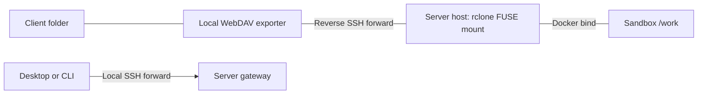

# Remote client-folder mounting (Linux)

The client exports one selected folder with a small authenticated WebDAV server
bound to `127.0.0.1`. OpenSSH carries that endpoint through a reverse forward to
the Docker host. A host-side helper mounts it using **rclone 1.68.2 + FUSE** and
creates a normal gateway session. Docker bind-mounts the resulting filesystem at
`/work`. There is no synchronization/copy step. This is the primary read-write
workspace mode: its exporter limits content to 256 MiB and exported entries to
4096. Direct local RW binds require `ALLOW_LOCAL_RW=1` for trusted development;
runtime/Compose default to `0`, while `.env.example` sets `1` for local demos.



## Requirements and trust boundary

- Two Linux machines, or a Linux client and a separate Linux VM. Python 3.12+ and
  OpenSSH client on the client. No FUSE or incoming SSH server is needed there.
- Server: this repository at the same revision, the normal Compose stack,
  rootful Docker on that host, OpenSSH server, `fusermount3`, `/dev/fuse`, curl and
  rclone **1.68.2**. Docker Desktop and a Docker daemon on a third host are unsupported.
- The SSH user owns `WORKSPACE_ROOT` and can traverse its ancestors. Use a dedicated
  single-user development account. This is not multi-tenant hosting: that account
  can run host commands, and Docker access is host-level authority.
- SSH key authentication must already work. Verify the host fingerprint when first
  connecting interactively. Runtime connections require `StrictHostKeyChecking=yes`
  and `BatchMode=yes`; they never silently trust a new host or ask for a password.
- sshd must permit TCP forwarding and retain `GatewayPorts no`. Both forwarded
  listeners bind to loopback. Keep `GATEWAY_BIND=127.0.0.1`; only SSH needs to be
  reachable across the network. `--ssh-config` can select a dedicated client config.

## Prepare the server

From its repository directory, initialize `.env` and start the existing stack:

```bash
python3 -m scripts.init
docker compose up --build -d --wait
```

For a server used by live/untrusted tasks, set `ALLOW_LOCAL_RW=0` in `.env` before
starting. Remote RW sessions remain available through the quota-controlled export.
If only the client has provider connectivity, use the optional
[SSH Unix-socket provider route](../README.md#optional-provider-route-through-the-clients-proxy).
The provider key remains on the server; the folder export never needs it.

Install the OS dependencies if missing. Fedora:

```bash
sudo dnf install fuse3 openssh-server curl
sudo systemctl enable --now sshd
```

Ubuntu/Debian:

```bash
sudo apt-get install fuse3 openssh-server curl
sudo systemctl enable --now ssh
```

In `/etc/fuse.conf`, enable the line `user_allow_other`. This permits the sandbox's
non-root UID to access the host user's FUSE mount. The helper passes the configured
`SANDBOX_UID` and `SANDBOX_GID` to rclone, with file mode `0600` and directory
mode `0700`; other ordinary host users cannot access the export. The sandbox remains networkless and does
not receive `/dev/fuse`, SSH keys, the Docker socket or the export credential.

Install the pinned rclone binary (Linux x86_64/aarch64):

```bash
python3 -m scripts.install_rclone
```

The installer verifies a pinned archive SHA256 from the release's official
`SHA256SUMS`, then installs into `~/.local/bin`. The helper checks this directory
explicitly, so it also works in SSH's non-interactive environment. No system rclone
is overwritten. `rclone version` must report 1.68.2 if using a system installation.

Rebuild Compose after updating the repository: the manager needs the mount-lease
checks. Keep the server's `.env` on the server. Only `CLIENT_TOKEN` is needed on
the client; do not copy `INTERNAL_TOKEN` or `LLM_API_KEY` there.

## Run from the client

Obtain the server's `CLIENT_TOKEN` securely. Set it without putting it in shell
history or command-line arguments:

```bash
read -rs -p 'CLIENT_TOKEN: ' CLIENT_TOKEN
export CLIENT_TOKEN
```

Test SSH interactively once, using the actual user and address:

```bash
ssh user@server
```

Start the desktop app from the client's copy of this repository:

```bash
python3 -m client gui \
  --ssh-host user@server \
  --server-repo '/home/user/itmo-agent-runtime-track-a'
```

Choose **any existing local folder** and click Connect. The folder no longer has
to be under the server's `WORKSPACE_ROOT`. Choose `ro` or `rw` before connecting.
The Server field displays the SSH destination. Closing the app releases the
session and unmounts the folder. Cancel stops the agent run; close/reconnect to
release that session and its mount. Reconnect events resumes the event cursor
while the tunnel lives. A lost mount requires a new connection/session.

Headless mode keeps the export alive until Ctrl+C:

```bash
python3 -m client mount \
  --ssh-host user@server \
  --server-repo '/home/user/itmo-agent-runtime-track-a' \
  --folder '/home/me/my-project' --mode rw
```

It prints `session_id`, the **local forwarded gateway URL**, and a remote workspace
ID. Use that URL and session in another terminal with the existing `send`, `watch`,
`collect`, `cancel` and `release` commands. Keep the mount terminal running.
Alternatively, add `--text 'your task'` to run one request and unmount afterwards.
Arbitrary requests require a real model configured on the server; replay remains
limited to bundled BAF prompts. Add `--ssh-port` or `--gateway-port` for custom ports.

## Filesystem behavior and limits

- Changes go directly to the client's filesystem. Directory/attribute caching and
  rclone disk caching are disabled; reopen files to observe external edits. Reads
  already in progress are not transactional snapshots.
- Supported: listing/stat, reads (including ranges), whole-file writes, mkdir,
  file rename, file deletion and removal of empty directories. UTF-8 filenames
  and binary contents are supported. File contents are limited to **64 MiB per PUT**.
- Total exported regular-file content is limited to **256 MiB**, with **4096 file
  or directory entries** and path depth 64. Uploads account for both the old target
  and staging file before replacement. Over-budget requests fail with HTTP 507
  and preserve the old target. These logical bounds are not filesystem block
  quotas; trusted local edits can grow the folder independently. Protected `.git`
  is excluded. See [quota accounting and failure boundaries](hardening.md).
- This is a WebDAV-backed filesystem, **not full POSIX**. With rclone's uncached VFS,
  append, seek-while-writing and read/write opens are unsupported or have different
  semantics. Use whole-file replacement (`WriteFile`, `Path.write_text/write_bytes`)
  or write a new file then rename it. Directory MOVE, chmod, symlinks, hard links,
  special files and Git operations are not supported. Run scripts via their
  interpreter (`python script.py`, `sh build.sh`), not their executable bit.
- `.git` at any depth is hidden and rejected for both reads and writes. A directory
  containing protected entries cannot be recursively deleted or renamed remotely.
  This intentionally protects more than CP1's read-only top-level `.git` bind.
- Path traversal and symlinks are rejected using descriptor-relative operations
  with `O_NOFOLLOW`. Hard-linked regular files are also rejected. The local user
  and server SSH account remain trusted; this is not isolation against a hostile
  local filesystem administrator.
- PUT stages data **on the client**, then atomically replaces the destination.
  A failed/incomplete upload leaves the old file untouched. A local change detected
  during upload returns HTTP 409. This is not distributed locking: a local edit
  immediately after the final check can still race. Avoid simultaneously editing
  the same file. Exporter processes of the same OS user reject overlapping
  parent/child exports in either direction using descriptor/inode registry locks;
  disjoint siblings remain available. PUT/MOVE/DELETE honor ETag preconditions
  and recheck relevant file versions before mutation. These checks do not provide
  global distributed locks or POSIX transactions against an external local editor.
- RO is enforced in the exporter, rclone and Docker bind mount. Mount credentials
  are per-export, sent over SSH stdin and passed to rclone through its environment;
  they do not enter command arguments, workspace metadata or sandbox variables.

## Disconnect and cleanup

A separate host `runtime.mount_guard` process owns rclone/FUSE, probes the client
every second with a 3-second request timeout and renews a 10-second lease. The SSH
helper owns the gateway session and a control pipe to that guard. EOF on the pipe,
including helper SIGKILL, tells the surviving guard to revoke the lease, stop
rclone, unmount and remove only empty metadata/mountpoint paths. The manager checks that lease before starting and while
polling commands; an independent watchdog checks active command labels and leases
every 250 ms. Both use the privileged Docker control plane. Missing/revoked/expired leases produce a terminal `transport`
error and container cleanup; operations are not retried automatically. Normal
release cancels the session before unmounting. SSH EOF and exporter failure trigger
release and unmount on the host. A blank underlying mountpoint has mode `000`, so
loss of FUSE cannot silently redirect sandbox writes into an ordinary host folder.

No rclone disk cache is created. Temporary upload data is on the client and removed
on failure. After clean release the server mountpoint and lease are removed; user
originals remain on the client. JSONL session metadata remains under the existing
trace retention policy, without file contents. `.remote-control/` is reserved for
public lease metadata and cannot be selected as a workspace.

A helper SIGKILL is handled by the independent mount guard; this does not make
the gateway session durable or guarantee a final client event after SSH loss.
A host crash, guard SIGKILL or failure of its unmount operation can still require
manual FUSE recovery. Lease expiry prevents new commands and stops running
commands through the manager or independent watchdog. Recorded command deadlines
survive manager/harness process loss, but timely cleanup is not guaranteed if
Docker or both control-plane services are unavailable. Operations are never
automatically reexecuted after transport failure. Inspect an orphan using:

```bash
python3 -m scripts.inspect_remote remote-REPLACE_WITH_ID
```

For a stale mount, stop its specific rclone process, unmount that exact directory
with `fusermount3 -u PATH` (or `-uz` if stale), and remove the empty directory/lease.
Never recursively delete a directory that might still be mounted to client data.
Unmount/release failures are reported rather than treated as successful cleanup.

## Verification

Offline tests include exporter permissions, traversal/symlink/hard-link rejection,
interrupted uploads, concurrent local edits and lease-expiry process cleanup:

```bash
python3 -m unittest tests.test_remote_mount -v
python3 -m scripts.check_webdav --rclone "$HOME/.local/bin/rclone"
```

For the actual two-machine acceptance test, start a disposable server in
`LLM_MODE=replay`, then run **on the client**:

```bash
python3 -m scripts.check_remote \
  --ssh-host user@server \
  --server-repo '/home/user/itmo-agent-runtime-track-a'
```

The SSH user needs Docker socket access for the read-only cleanup inspection.
The test uses its own temporary client folder, runs a sandbox task, observes the
result on the client, changes a client filename, repeats the task, checks RO,
and breaks SSH. A separate SSH connection verifies that mounts, lease files and
containers are gone. Evidence is saved in `results/remote-mount.json`.

CI runs the same acceptance script against a disposable loopback sshd plus real
FUSE and Docker. This verifies the transport locally; a successful run is not
proof of a demonstration on two physical machines/VMs. The user completed the actual Fedora-client → Ubuntu-VM acceptance run:
`results/remote-mount.json` records nine passing checks, including bidirectional
visibility, RO rejection, release and disconnect cleanup. The user also confirmed
the GUI path and output appearing in the client folder. This verifies that setup,
not arbitrary hosts or unsupported filesystem operations.

The historical Ubuntu `make check-all` also passed: 169 offline tests, real Docker
isolation/grading, 10 hardening checks, 39/39 real-Docker replay tasks and nine
SSH/FUSE checks. The historical Fedora offline suite passed 169 tests. Those
artifacts precede the separate mount guard and new export-conflict fixes. A later
real Ubuntu helper-SIGKILL probe passed three checks; current full acceptance is
tracked separately in [the fixes report](cp2-fixes.md#validation-status). Mounted-filesystem
and sandbox measurements completed with ten repeats per metric, including client
verification of the final remote write and cleanup. See
[measured tables and limitations](cp2-report.md#measured-performance) and
[raw acceptance/measurement evidence](evidence/cp2/README.md).

For the complete prepared-host acceptance suite and filesystem timings:

```bash
# Docker host, after preparing images, rclone and FUSE:
make check-all CHECK_ARGS=--existing-sshd

# Client, with SSH configuration and server CLIENT_TOKEN available:
python3 -m scripts.measure_mount --ssh-host YOUR_SSH_ALIAS \
  --server-repo /home/YOUR_USER/itmo-agent-runtime-track-a --repeats 10
```

See [measurement definitions and raw reports](performance.md). Measurement scripts
use trusted fixtures and do not call an LLM. The separate complete live campaign
used this two-machine path for all 117 attempts. It scored 114/117 after audited
checker corrections; original verdicts and failures remain available in the
[CP2 report](cp2-report.md#first-pair-results-and-corrections).

Sources: [rclone mount/VFS semantics](https://rclone.org/commands/rclone_mount/),
[WebDAV backend](https://rclone.org/webdav/),
[OpenSSH forwarding](https://man.openbsd.org/ssh.1),
[pinned release checksums](https://downloads.rclone.org/v1.68.2/SHA256SUMS).
